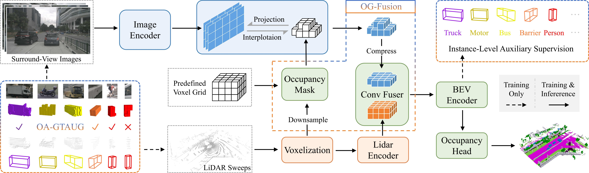

# DAOccV2

> **DAOccV2: Efficient Fusion and Occlusion-Aware Augmentation for Multi-Modal 3D Occupancy Prediction**
>
> Zhen Yang, Pengyi Guo, Jiayu Wang, Yanpeng Dong, Jiwen Lu

DAOccV2 is an efficient camera-LiDAR 3D occupancy prediction framework built upon [DAOcc](https://github.com/AlphaPlusTT/DAOcc). It improves inference efficiency by skipping dense image feature lifting for empty voxels and enhances foreground occupancy prediction through occlusion-aware ground truth augmentation and instance-level auxiliary supervision.



## Highlights

- **Efficient and accurate.** On Occ3D-nuScenes with camera masks, DAOccV2 reaches **56.47 mIoU at 8.3 FPS**.

## News

- **2026-07-10:** Release the model weights and the first version of the code.

## Experimental Results

### Occ3D-nuScenes

|   Model   |  Training setting  | mIoU  | RayIoU | mIoU<sub>F</sub> | FPS | Config |                   Weights                   |
|:---------:|:------------------:|:-----:|:------:|:----------------:|:---:|:-:|:-------------------------------------------:|
|  DAOccV2  |   w/ camera mask   | 56.47 |   -    |      55.53       | 8.3 | [config](configs/nuscenes/occ3d/daoccv2_occ3d_nus_w_mask.yaml) | [weights](https://huggingface.co/yz106/DAOccV2/blob/main/daoccv2_occ3d_nus_w_mask.pth)  |
|  DAOccV2  |  w/o camera mask   | 50.6  |  50.4  |       52.2       | 8.3 | [config](configs/nuscenes/occ3d/daoccv2_occ3d_nus_wo_mask.yaml) | [weights](https://huggingface.co/yz106/DAOccV2/blob/main/daoccv2_occ3d_nus_wo_mask.pth) |

### SurroundOcc

|  Model  | IoU  | mIoU | mIoU<sub>F</sub> |                             Config                              |                Weights                |
|:-------:|:----:|:----:|:----------------:|:---------------------------------------------------------------:|:-------------------------------------:|
| DAOccV2 | 45.4 | 32.7 |       31.2       | [config](configs/nuscenes/surroundocc/daoccv2_surroundocc.yaml) | [weights](https://huggingface.co/yz106/DAOccV2/blob/main/daoccv2_surroundocc.pth) |

### Occ3D-Waymo

|   Model   | Training setting | mIoU  | mIoU<sub>F</sub> |                            Config                             | Weights |
|:---------:|:--:|:-----:|:----------------:|:-------------------------------------------------------------:|:-------:|
|  DAOccV2  | w/ camera mask | 47.38 |      39.30       | [config](configs/waymo/occ3d/daoccv2_occ3d_waymo_w_mask.yaml) |    -    |

- Weights trained on Waymo cannot be shared per Waymo’s regulations.
- Following prior works, the Occ3D-Waymo experiment uses 20% of the training data.
- $mIoU_F$ denotes the mean IoU over foreground classes.

## Getting Started

- [Installation](docs/install.md)
- [Prepare datasets](docs/data.md)
- [Training and evaluation](docs/run.md)
- [Visualization](docs/vis.md)

## Citation

Citation information for DAOccV2 will be added when the paper is publicly available. If this codebase or its DAOcc foundation is useful in your research, please also cite:

```bibtex
@article{yang2025daocc,
  title={Daocc: 3d object detection assisted multi-sensor fusion for 3d occupancy prediction},
  author={Yang, Zhen and Dong, Yanpeng and Wang, Jiayu and Wang, Heng and Ma, Lichao and Cui, Zijian and Liu, Qi and Pei, Haoran and Zhang, Kexin and Zhang, Chao},
  journal={IEEE Transactions on Circuits and Systems for Video Technology},
  year={2025},
  publisher={IEEE}
}
```

## Acknowledgements

This project builds upon these excellent open-source codebases:

- [MMDetection3D](https://github.com/open-mmlab/mmdetection3d)
- [DAOcc](https://github.com/ZYang2077/DAOcc)